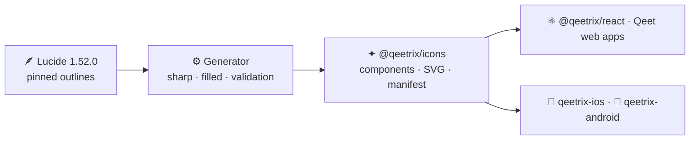

<div align="center">

# ✦ Qeetrix Icons

**The icon and logo library of Qeetrix, the Qeet Group design system: 1,863 icons in round and sharp, 775 filled,
and the Qeet logos, as typed, tree-shakeable React 19 components.**

[](https://www.npmjs.com/package/@qeetrix/icons)
[](https://github.com/qeetgroup/qeetrix-icons/actions/workflows/ci.yml)
[](#-whats-inside)
[](docs/sharp.md)
[](https://react.dev)
[](LICENSE)

[🌐 ui.qeet.in/icons](https://ui.qeet.in/icons) · [🚀 Quick start](#-quick-start) · [📘 API](docs/api.md) · [🟠 Logos](docs/logos.md) · [📝 Changelog](CHANGELOG.md)

</div>

```tsx
import { TrashIcon, StarIcon, QeetLogo } from "@qeetrix/icons";

<TrashIcon />                                  // round outline
<StarIcon variant="filled" />                  // round filled
<TrashIcon shape="sharp" />                    // sharp outline
<StarIcon shape="sharp" variant="filled" />    // sharp filled
<QeetLogo height={32} aria-label="Qeet" />     // the Qeet logo, exactly as drawn
```

## 📦 What's inside

| | |
|:--|:--|
| 🎨 **1,863 icons** | Lucide 1.52.0's whole set, in its 42 categories, with its names and tags |
| 🔷 **Round and sharp** | Every icon in Lucide's round drawing and a sharp one (square caps, mitred joins), behind one `shape` prop |
| 🌓 **775 filled** | Filled drawings for selected, active and favourite states, in both shapes, reviewed category by category |
| 🟠 **The Qeet logos** | The Qeet mark and wordmark, embedded byte for byte, a file for light and one for dark surfaces |
| 🔎 **A searchable catalogue** | Tags, categories, Lucide's former names and right-to-left behaviour, as data for docs and pickers |
| 🧱 **Beyond React** | Every drawing and logo as a plain SVG file, and the catalogue as JSON, for Android, iOS and design tools |
| 🌲 **Nothing you didn't import** | No runtime dependencies, no hooks, no side effects: bundlers keep only what you use |

## 🔗 How it fits



## 🚀 Quick start

```sh
bun add @qeetrix/icons
```

React 19 is the only peer dependency; the package is compiled ESM with types, so it works in Vite, Next.js, TanStack
Start and React Server Components as it is.

```tsx
import { BellIcon, SearchIcon, StarIcon } from "@qeetrix/icons";

export function Toolbar({ starred }: { starred: boolean }) {
  return (
    <nav>
      <SearchIcon size={20} />
      <BellIcon variant="filled" aria-label="Notifications" />
      <StarIcon variant={starred ? "filled" : "outline"} shape="sharp" />
    </nav>
  );
}
```

Icons draw in `currentColor` and are decorative unless named (`aria-label`); `size` takes pixels or any CSS length
(default 24). A `variant` an icon doesn't have is a type error. Coming from `lucide-react`? Most screens move over
with an import change: [the migration table](docs/migrating-from-lucide-react.md).

## 📚 Learn more

| | |
|:--|:--|
| 📘 [API](docs/api.md) · 🏷️ [Naming](docs/naming.md) | Every import, `IconProps`, the manifests, entry points and tree shaking; how names map |
| 🔷 [Sharp](docs/sharp.md) · 🌓 [Filled](docs/filled.md) · 📐 [Design](docs/design.md) | How the sharp and filled drawings are derived, and the design rules |
| 🟠 [Logos](docs/logos.md) | The Qeet logos: files, backgrounds, clear space and minimum sizes |
| ♿ [Accessibility](docs/accessibility.md) · ↔️ [Right to left](docs/rtl.md) | Decorative defaults, named icons, and which icons mirror |
| 🏗️ [Architecture](docs/architecture.md) · ⚙️ [Generation](docs/generation.md) · ✅ [Validation](docs/validation.md) | The pipeline, what's generated, and every check |
| 🪶 [Lucide](docs/lucide.md) · 🧪 [Visual QA](docs/visual-qa.md) | The upstream and its upgrades; the playground and the review workflow |

## 🛠️ Develop

```sh
bun install
bun run test         # every suite, including a packed-tarball consumer test
bun run playground   # the visual QA playground
```

Before every push, run the whole local gate (lint, typecheck, the tests, the icon, filled, sharp, generated, brand
and logo checks, the build and the playground build): [docs/contributing.md](docs/contributing.md), "Before you
push".

## 🚢 Releases

Work lands on `develop`. A pull request from `develop` into `main` with the version raised (and its
[changelog](CHANGELOG.md) section) releases it: merging publishes to npm and tags `vX.Y.Z`
([releases](docs/releases.md)).

## 🗂️ The Qeetrix family

| Repository | What it is |
|:--|:--|
| **qeetrix-icons** | The icons and the Qeet logos (this repository) |
| [qeetrix-react](https://github.com/qeetgroup/qeetrix-react) | `@qeetrix/react`, the React components, which draw these icons |
| [qeetrix-tokens](https://github.com/qeetgroup/qeetrix-tokens) | `@qeetrix/tokens`, whose `ICON_SIZE` and `ICON_STROKE` these icons match |
| [qeetrix-ios](https://github.com/qeetgroup/qeetrix-ios) · [qeetrix-android](https://github.com/qeetgroup/qeetrix-android) | Qeetrix for the apps, with every icon generated from this package |

## 📄 License

[MIT](LICENSE) © Qeet Group. The icon artwork comes from [Lucide](https://lucide.dev) under the ISC licence
([lucide.md](docs/lucide.md)); the Qeet logos are Qeet Group's own, and the Qeet name and mark are its trademarks.
